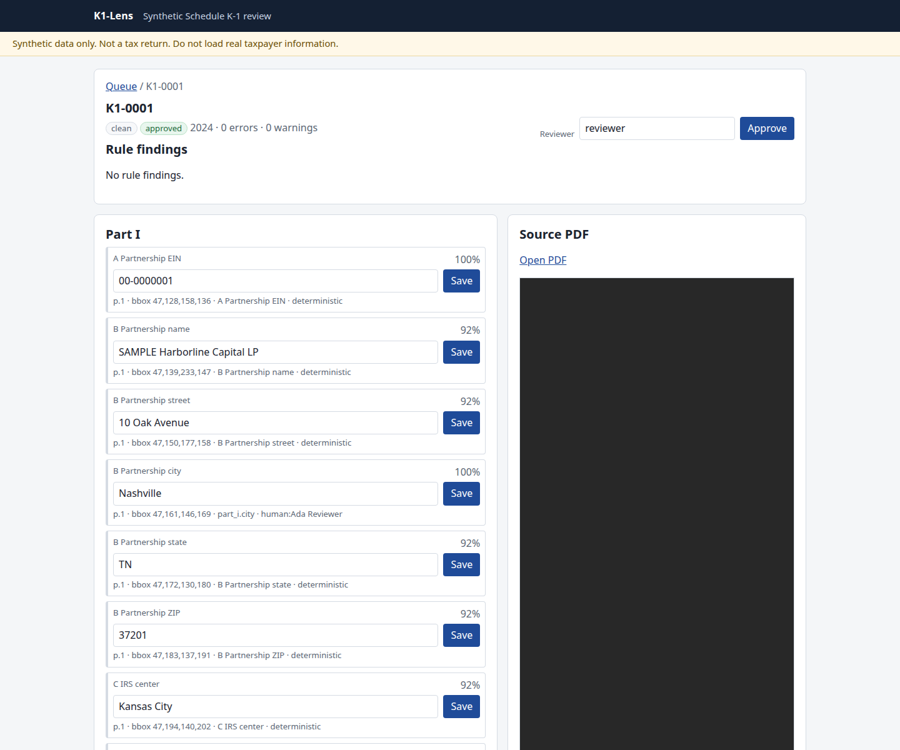
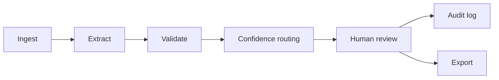

# K1-Lens

K1-Lens turns a synthetic IRS Schedule K-1 (Form 1065) into a typed record, checks it with deterministic rules, and holds low-confidence fields for a person before anything is exported. It is a document engine plus human review: confidence and provenance on every field, an append-only audit log, and CSV or Excel of approved rows. K1-Lens was implemented by an AI coding agent (Cursor) working under Matthew Thornhill's direction. Matthew set the requirements, the evaluation protocol, and the acceptance checks.

**Synthetic data only.** Every name, address, EIN, and amount is generated. EINs use the `00-` prefix and SSNs use `000-`. Those ranges are obviously synthetic: they are not issued by the IRS or SSA. The id check is a format check (nine digits, the EIN or SSN dash pattern, and not masked). It accepts those test ranges on purpose. Do not load real taxpayer data. An example roster is `fixtures/example-roster.json`. Pass it with `--roster` or `K1LENS_ROSTER`. Scoring does not load a roster unless you pass one.



## Results

Rules-only deterministic backend. Seed 1065. Review threshold 0.80. Tesseract 5.3.4 is the version on this measurement and on the Ubuntu CI runner. Another box measures differently on Tesseract 5.5.0. Document straight-through is the share of documents that need no review. Field straight-through is the share of comparisons stored at or above 0.80. A confident wrong value is a mismatch or a spurious extraction at or above 0.80. The committed reports pass no roster. Definitions and the calibration tables are in [the evaluation note](docs/EVALUATION.md).

A matched identity section is lifted to exactly 0.80, and not higher. The lift runs only when the key id was read confidently and passes the format check, every field in that section matches the same roster record, and each value was read from its own field region. A partial match lifts nothing. Without a roster, or when the EIN or TIN is not in the roster, every name, street, city, state, and ZIP goes to review by design. Entity type is not in that set. The form prints no options for that item, and a roster match does not clear it. Unseen layouts are not supported.

### Without a roster

| Set | Accuracy | Precision | Field straight-through | Document straight-through | Confident wrong | Confidently read ids |
| --- | --- | --- | --- | --- | --- | --- |
| In distribution | 99.3% (884/890) | 99.9% (878/879) | 594/890 | 0.0% (0/14) | 0 | 21 of 28 |
| Scanned images | 54.8% (1048/1914) | 98.8% (1048/1061) | 596/1914 | 0.0% (0/30) | 0 | 21 of 60 |
| Dev layouts | 68.0% (349/513) | 100.0% (349/349) | 217/513 | 0.0% (0/8) | 0 | 8 of 16 |
| Dev layouts, statement | 35.9% (92/256) | 100.0% (92/92) | 0/256 | 0.0% (0/4) | 0 | included in the 8 of 16 |
| Dev layouts, dev_b | 98.4% (253/257) | 100.0% (253/253) | 213/257 | 0.0% (0/4) | 0 | 8 of 8 |
| Colon-free layouts | 100.0% (767/767) | 100.0% (767/767) | 304/767 | 0.0% (0/12) | 0 | 24 of 24 |

### With a roster built from that set's ground truth

`k1lens write-roster --fixtures DIR --out PATH` copies name, EIN or TIN, street, city, state, and ZIP from that corpus's ground-truth JSON. Those documents' identity was known before scoring. `evaluate()` does not build that file. Pass it with `k1lens eval --roster PATH`. Accuracy and precision match the table above, because the page value is never replaced. The 0.80 bucket has 0 errors on every set.

| Set | Field straight-through | Document straight-through | Confident wrong |
| --- | --- | --- | --- |
| In distribution | 689/890 | 28.6% (4/14) | 0 |
| Scanned images | 691/1914 | 0.0% (0/30) | 0 |
| Dev layouts | 257/513 | 50.0% (4/8) | 0 |
| Dev layouts, dev_b | 253/257 | 0.0% (0/4) | 0 |
| Colon-free layouts | 424/767 | 25.0% (3/12) | 0 |

In distribution, the four clean documents clear and every other variant stays in review. Development layouts: `layout_shift` is 4/4 and `dev_statement` stays 0/4 because that layout is unrecognized. `dev_b` stays 0/4 because the tax year is missed. Colon-free: `stacked` is 2/2 and `stacked_columns` is 1/2. The same-line layouts stay in review because a wide gap keeps correct amounts at 0.784. Scans stay 0/30. Field straight-through on scans is 691/1914 and on the colon-free set is 424/767: a matched own-region field is lifted to exactly 0.80 even when the extractor's own score was lower. Document straight-through does not move, because the other gates still hold those documents. Confidently read ids are the same counts as the no-roster table. A lift needs a confident id plus a full exact match.

### Unseen roster entries

A document whose EIN and TIN are not in the roster stays at document straight-through 0. The finding is `new_partner`. `fixtures/example-roster.json` uses EIN `00-9000001` and SSN `000-90-0001`. Those keys are not the generated corpora. Eval does not load that file unless you pass `--roster`. A test scores one clean document against it, and straight-through is 0.

The colon-free set is a round-trip. It prints the same catalog strings the extractor lists, from seed 1065, with no colon: a right-aligned amount, a box grid, two columns, a mixed statement, and a label with the amount on the next line in the same column. It is not evidence for an unseen layout. Every field matched. With no roster, document straight-through is 0/12 and field straight-through is 304/767. Identity fields sit under 0.80 because no roster was passed. The eight same-line documents also stay in review because a wide gap keeps correct amounts at 0.784. Sitting in the label's column chooses the value. It is not scored as proximity 1, so an exact catalog label with a right-aligned amount stays at 0.784. The weights were not refit. `dev_statement` capital lines stay misses because those captions are not catalog labels. The straight-through floors are the no-roster document rates, 0/14, 0/8, 0/4, and 0/12. They are minimums and have no ceiling. Accuracy and precision floors did not move. Unseen layouts are not supported yet. On the measured sets in this table, with a roster and without one, a wrong value does not clear 0.80. An independent blind check is how an unseen layout gets measured. The held-out set is scored by an independent reviewer; not in this repo.

An EIN or TIN is a roster key only when it is read exactly and confidently. The format check is nine digits, the EIN dash pattern or the SSN dash pattern, and not masked. EINs that start with `00-` and SSNs that start with `000-` are accepted on purpose. Those ranges are obviously synthetic. They are not issued by the IRS or SSA. A masked id, with asterisks or Xs or only the last four digits, is `no_tin` and is not a key. Digits are never repaired, guessed, or check-digit-corrected. If the id's own confidence is under the review threshold, including a well-formed text-layer read, it is not a key (`no_roster_match`). If OCR word confidence on any id digit is under the review threshold, the id is not a match either. Each report counts sections that had a confidently read id, scans included. Two roster records with the same EIN or TIN are `duplicate_roster_key` and are not a match.

A blank field on the page against a complete roster record is held (`identity_mismatch`). ZIP matches after whitespace is removed, and the hyphen stays, so ZIP5 against ZIP+4 is a mismatch. Adding or dropping a middle initial is a mismatch. Case and repeated whitespace are the only other normalization. A roster record with a blank field cannot clear that field, and the whole section stays under 0.80. The right id with the wrong name, the right id with the wrong address, and a name that belongs to a different record are `identity_mismatch`. Nothing lifts on a partial match. The stored value is the page string, even when the roster's case or spacing differs. A full exact match lifts each of those fields to exactly 0.80, not higher, and only when each value was read from its own field region, with no fallback, repair, or model value. Each lifted field is an audit row whose action is `roster_exact_match`. A lift needs a confident id plus a full exact match.

The tables are the deterministic backend. Live confident-wrong is 0 on hybrid and on llm, in both runs, on every repository set. Those figures were measured on the pre-release source of v0.1.0 (src/ differs from the tag only in one docstring). The report is [docs/eval-live/report.md](docs/eval-live/report.md), with `report-run1.json` and `report-run2.json` beside it. Every live run passed a roster built with `k1lens write-roster` from the same ground-truth JSON the eval scores against, so the identity of every matched document was known before scoring. Unseen layouts are not supported. The live measurement used Tesseract 5.5.0. The deterministic tables above used Tesseract 5.3.4. Model `gpt-4o-mini`. Estimated spend for the repository sets, both backends and both runs, is $0.341834.

| Set | Hybrid run 1 | Hybrid run 2 | Llm run 1 | Llm run 2 |
| --- | --- | --- | --- | --- |
| In distribution | 0 | 0 | 0 | 0 |
| Development | 0 | 0 | 0 | 0 |
| dev_b | 0 | 0 | 0 | 0 |
| Colon-free | 0 | 0 | 0 | 0 |
| Scans | 0 | 0 | 0 | 0 |

Hybrid, both runs: in distribution 99.3% (884/890) at precision 99.9% (878/879), field straight-through 77.4% (689/890), document straight-through 28.6% (4/14). Development 68.0% (349/513) at precision 100.0% (349/349), field straight-through 50.1% (257/513), document straight-through 50.0% (4/8). dev_b 98.4% (253/257) at precision 100.0% (253/253), field straight-through 98.4% (253/257), document straight-through 0.0% (0/4). Colon-free 100.0% (767/767) at precision 100.0% (767/767), field straight-through 55.3% (424/767), document straight-through 25.0% (3/12). Scans 55.3% (1059/1914) at precision 99.2% (1059/1068), field straight-through 38.6% (739/1914), document straight-through 0.0% (0/30).

Llm field straight-through is 0.0% and document straight-through is 0.0% on every set in both runs. Llm run 1: in distribution 94.9% (845/890) at precision 99.9% (839/840); development 88.4% (473/535) at precision 99.1% (453/457); dev_b 84.1% (217/258) at precision 99.5% (217/218); colon-free 92.3% (708/767) at precision 99.0% (708/715); scans 51.3% (991/1932) at precision 89.6% (977/1090). Llm run 2: in distribution 94.9% (845/890) at precision 99.9% (839/840); development 87.9% (459/522) at precision 98.9% (453/458); dev_b 84.1% (217/258) at precision 99.5% (217/218); colon-free 92.3% (708/767) at precision 99.0% (708/715); scans 51.2% (987/1927) at precision 91.6% (974/1063).

The model is not on the identity path. A model identity value at any confidence stays under 0.80. Hybrid calls the model when the layout is unrecognized, or when a field is missing or below the review threshold. It stores the model's value only for a missing money or percent amount, a missing coded-line amount, or a missing tax year, and only when that string is in the field's own label region. A coded line the rules did not read is stored only when the layout is unrecognized. A field that already has a value keeps the rules value. The stored confidence is never raised above the number the model reported, and it stays at or below below_review_threshold (0.49 when the threshold is 0.80). A non-finite model confidence is rejected. Llm mode never clears a field. Every llm value goes to review.

## Quickstart

Python 3.12 and [uv](https://docs.astral.sh/uv/) 0.12.23. Image-only pages need a `tesseract-ocr` binary.

```bash
uv sync
uv run k1lens generate
uv run k1lens serve
```

`generate` writes 14 synthetic documents to `fixtures/synthetic` with seed 1065. `serve` opens the review app at http://127.0.0.1:8000. Swagger UI is at http://127.0.0.1:8000/docs and is served by the app. Those fixture files are not stored in git.

## Known failure cases

Six catalog pages are damaged on purpose. Two mild scans misread item L withdrawals. Those misreads stay under 0.80, so the confident-wrong count is 0. Identity fields stay under 0.80 unless a confident id and a full exact roster match lift that section to exactly 0.80. The full write-up is in [Known failure cases](docs/EVALUATION.md#known-failure-cases).

| Document | What went wrong | Flagged |
| --- | --- | --- |
| K1-FAIL-0001 | 40 DPI. All 66 fields missed. | Confidence 0.00 |
| K1-FAIL-0002 | 20° rotation and skew. All 72 fields missed. | Confidence 0.00 |
| K1-FAIL-0003 | Stain covers most of both pages. 56 of 59 fields missed. | Misses under 0.80 (54 at 0.00, 2 at 0.25) |
| K1-FAIL-0004 | Handwriting across lines. 26 missed, 37 matched. | Misses under 0.80 |
| K1-FAIL-0005 | Bottom 72% of the page cropped. 35 missed, 25 matched. | Misses at 0.00 |
| K1-FAIL-0006 | Faded almost to white. All 61 fields missed. | Confidence 0.00 |
| K1-SCAN-0004 | Withdrawals 9298 read as 298.00. | 0.66 |
| K1-SCAN-0013 | Withdrawals 14365 read as 44365.00. | 0.62 |
| Entity type | The form prints no options for entity type. It is not a name or an address, and a roster match does not clear it. C corp and Income tax basis stay under 0.80. | Under 0.80 |
| Identity fields | Name, street, city, state, and ZIP are lifted to exactly 0.80 only when a confident id and a full exact match cover the whole section. The partnership section is keyed by the EIN. The partner section is keyed by the TIN. A partial match, a low-confidence or invalid id, a duplicate roster key, a model value, or a value from another region lifts nothing. The stored value is the page string. The audit action is `roster_exact_match`. | Under 0.80 without that lift |
| Clean catalog straight-through | Without a roster, K1-0001 through K1-0004 stay in review. With a roster built from those documents' ground truth, those four clear. Passing `fixtures/example-roster.json` does not, because its keys are not these documents. | Under 0.80 without that roster |

The live measurement is [docs/eval-live/report.md](docs/eval-live/report.md), on the pre-release source of v0.1.0 (src/ differs from the tag only in one docstring). No number in the known-failure table comes from a model call. The tests play back recorded HTTP responses.

To run the model yourself, with only `OPENAI_API_KEY` set:

```bash
uv run k1lens eval --backend hybrid --live
```

That scores the in-distribution set, the development layouts in `fixtures/dev`, `dev_b`, the colon-free `fixtures/dev_geometry` layouts, and the scans. The default command writes `docs/eval-live/report.md` and `docs/eval-live/report.json`. A default `eval --live` run overwrites `docs/eval-live/report.md`. It records accuracy, precision, confident-wrong count, straight-through rate, tokens, cost per document and per page, LLM call count, fields requested, malformed replies, a hybrid-versus-deterministic table, and one row per field. The default model is `gpt-4o-mini`, which accepts page images. Change it with `--model` or `K1LENS_OPENAI_MODEL`. A hard spend ceiling stops the run before the next call; the default is `$3` (`--max-spend`). `--max-documents N` scores at most N documents in each set. Page images are sent at low detail only when the PDF has no text layer. The key and request headers are not printed and are not written into the report. The committed report is [docs/eval-live/report.md](docs/eval-live/report.md), with `report-run1.json` and `report-run2.json` beside it, measured on the pre-release source of v0.1.0 (src/ differs from the tag only in one docstring).

## Privacy and production gaps

K1-Lens is a demo on synthetic data. It is not ready for real taxpayer data. These gaps are known and deliberate for a demo:

- No authentication. The review app and API accept any caller, and the reviewer name is whatever the caller types. The CLI binds to 127.0.0.1 by default, but the Docker image binds 0.0.0.0 and docker-compose.yml publishes port 8000.
- Full EINs and TINs are shown unmasked in the API, the review pages, the CSV and Excel exports, the PDF endpoint and some validation messages.
- The audit log is hash-chained and append-only by design. It stores old and new values in plain text, including the TIN in the approval snapshot. Database triggers block UPDATE and DELETE, so a record cannot be erased from it.
- The SQLite database stores each uploaded PDF and its extracted JSON unencrypted, with no retention period and no purge command. In Docker it lives on a persistent volume.
- The opt-in LLM path sends the full, unredacted page text (the text layer, or OCR text for a scan) to OpenAI or Anthropic. Page images go only to OpenAI: with vision on, as in `eval --live`, a PDF with no text layer is also sent to OpenAI as low-detail page images. The Anthropic path sends text only. Requests do not set store:false.
- There is no documented data retention policy.
- Swagger /docs is always on, and some 400 errors echo the submitted value.

Before real data: authentication and per-user reviewer identity, a localhost-only or private-network bind, TIN masking in every output, a keyed hash instead of the raw TIN in the audit log, redaction of identifiers before any model call with store:false or a zero-retention agreement, encryption at rest, and a documented retention and purge policy that reconciles the append-only log with deletion requests.

## Architecture



Extraction is deterministic first. Colon lines are read as `Label: value`. A line with no colon is paired from word positions. The label's region on that line ends at the next label, not at the end of the line, so a right-aligned amount stays with its label and the next column does not. An amount on the next line counts when it overlaps that column. A name is not taken from another column. A name that has already left its label and then jumps across a gutter into an amount is that next column, and it is not stored. Whether the next line is the name is decided by the name shape, not by a list of phrases. A street, a numbered heading that is not a name, a line that ends in a role word, a line that contains by, or a line made only of caption words is not stored, and the label stays open so the next real line in that column can fill it. A status phrase that fails the shape is stored and stays under 0.80. When the printed caption is longer than the catalog label, the whole caption is consumed before the value is taken, including a trailing instruction reference such as See instructions. A run of three or more identical non-alphanumeric characters is a leader, and so is a mixed run of dots, underscores, hyphens, equals signs, tildes, asterisks, and colons. A leader glued to the value is stripped. A hyphen inside a name, such as Wilkes-Barre, stays. On an OCR colon line, a trailing period is kept when the last token is abbreviation-shaped: a short title-case token such as Bros., Esq., Assoc., or Jr., or initials such as J. R. or L.P. Yes, No, True, and False are not abbreviations, so that separator period is dropped, and a trailing period on a capital-method checkbox is dropped before the method is matched. A separator period after any other token, including an all-caps LLC., is dropped. Tesseract runs with a subprocess timeout of 120 seconds. Every Tesseract subprocess is started with ``OMP_THREAD_LIMIT=1``. The eval command, live eval, and the Docker image set that same limit on the process. A page that fails OCR, including a timeout or a killed Tesseract process, is recorded on the document. A page with no words is sent to OCR even when another page of the same PDF has a text layer. Rule `ocr_page` is an error, so that document cannot go straight through or be approved until a person overrides it. Name, street, city, and state match after case and interior whitespace are folded. ZIP matches after all whitespace is removed, and the hyphen stays, so a ZIP code and a ZIP+4 are different. A middle initial added or dropped does not match. The partnership section is keyed by the EIN. The partner section is keyed by the TIN. Those five fields are lifted to exactly 0.80, and not higher, only when a roster is passed, the key id was read confidently, and every one of them matches the same record from its own field region. A partial match lifts nothing. The value stored is the page string. Each lifted field is an audit row whose action is `roster_exact_match`. Entity type is not one of those fields. The form prints no options for that item, and a roster match does not clear it. Periods are ignored, so L.L.C. is LLC. C corp and Income tax basis stay under 0.80. An id is a key only when it is nine digits in the EIN pattern `NN-NNNNNNN` or the SSN pattern `NNN-NN-NNNN` and it is not masked. EINs starting with `00-` and SSNs starting with `000-` are accepted. Those ranges are obviously synthetic. They are not issued by the IRS or SSA. Asterisks, Xs, or only the last four digits are `no_tin`. Digits are not repaired, guessed, or check-digit-corrected. If OCR word confidence on any id digit is under the review threshold, the id is not a match (`no_roster_match`). A blank field on the page against a complete roster record is `identity_mismatch`. A roster record with a blank field cannot clear that field. The right id with the wrong name, the right id with the wrong address, and a name that belongs to a different record are `identity_mismatch`. Two roster records with the same EIN or TIN are `duplicate_roster_key` and are not a match. A wrapped value whose continuation was not read stays under 0.80, and the missing words are not invented. An unrecognized layout does not lift. A conflict, a value that is not grounded, and a value that is not anchored were not read from that field's own region, so they are not lifted either. A statement, supplemental, or other-form row is not stored as a street, city, state, or ZIP. A blank name is not filled from the city line under it. A trailing period on a city is stripped. A value whose first word is see, refer, or enclosed is not stored. Not applicable, Not provided, Unknown, N/A, and None are not stored. A note or a next-line stray, such as 12, See statement, or Page 2, is not taken as the value. On the measured sets, with a roster and without one, a wrong value does not clear 0.80. That measurement is not a claim about an unseen layout. An independent blind check is how that gets measured. The model is not on the identity path. A model identity value at any confidence stays under 0.80. Hybrid calls the model when the layout is unrecognized, or when a field is missing or below the review threshold. It stores the model's value only for a missing money or percent amount, a missing coded-line amount, or a missing tax year, and only when that string is in the field's own label region. A coded line the rules did not read is stored only when the layout is unrecognized. A field that already has a value keeps the rules value. The stored confidence is never raised above the number the model reported, and it stays at or below below_review_threshold (0.49 when the threshold is 0.80). A non-finite model confidence is rejected. A finite confidence outside 0 to 1 is clamped into that range. Llm mode never clears a field. Every llm value goes to review. A blank line stays null. The model does not fill it with 0.00. A gap the model fills, including a missing tax year, is stored at or below below_review_threshold (0.49 when the threshold is 0.80). A value that sits in another field's column is not copied over. The LLM-only backend keeps every field on an unrecognized layout under 0.80. The LLM-only path stops on a persistent 5xx after one retry, on a timeout at the first failure, and on a malformed reply after one retry. A malformed reply includes a 200 that is not JSON and a 200 that is not valid UTF-8. Hybrid keeps the deterministic values in those three cases and the run continues. A 429 is retried once and then stops the run, and the stopped reason includes the status. Any other request failure stops on the first failure and the stopped reason names the exception class. OpenAI and Anthropic share one interface. The key is read from the environment. No key means that step does nothing. CSV and Excel cells whose first character is `=`, `+`, `@`, a tab, or a carriage return, or a leading minus that is not a plain number, are quoted so a spreadsheet does not treat them as a formula. An override of a blank field stores an empty string, and that empty string resolves the finding.

## Repository

The generated fixtures (the synthetic, dev, dev_b, dev_geometry and scans sets, JSON and PDFs) are produced from seed 1065 by `k1lens generate` and are not committed. `uv.lock` is 1,539 lines. Vendored Swagger UI is minified: `swagger-ui-bundle.js` is 1,452,753 bytes and `swagger-ui.css` is 152,071 bytes, about 1.6 MB, so `/docs` works with no CDN. It stays in the tree. The other committed artifacts are the eval reports, the screenshots, the small sample set in `fixtures/heldout` (2 synthetic sample documents plus a manifest), `fixtures/example-roster.json`, `docs/scan-hashes.json`, and `docs/eval-baseline.json`. Application source is under `src/k1lens`; the vendored Swagger files are in `src/k1lens/review/static/swagger`.

## More

| | |
| --- | --- |
| [Evaluation](docs/EVALUATION.md) | Per-set tables, calibration, and [known failure cases](docs/EVALUATION.md#known-failure-cases). |
| [Design](docs/DESIGN.md) | Schema, extractor, rules, review, waterfall, limitations. |
| [Decisions](docs/DECISIONS.md) | Options and tradeoffs. |

| Command | What it does |
| --- | --- |
| `k1lens generate` | Write a seeded corpus. Default seed `1065`, 14 documents. `--dev`, `--dev-b`, `--dev-geometry`, and `--scans` write the other sets. |
| `k1lens extract` | `deterministic` (default), `hybrid`, or `llm` when a key is set. `--roster PATH` is the same flag on `extract`, `validate`, `eval`, and `serve`. `K1LENS_ROSTER` is that path. |
| `k1lens validate` | Print rule findings. Pass `--roster` or every identity field is `no_roster`. |
| `k1lens eval` | Score one corpus. `--compare` scores deterministic, LLM-only, and hybrid offline. `--roster PATH` is optional. Without it, identity stays in review. |
| `k1lens write-roster` | `--fixtures DIR --out PATH` copies identity from that corpus's ground truth. Those documents' identity was known before scoring. Eval does not build this file. |
| `POST /api/roster` | JSON body of the roster. The review app rebinds every open document. |
| `k1lens eval --backend hybrid --live` | Call OpenAI on every set. Needs only `OPENAI_API_KEY`. The checked-in measurement is `docs/eval-live/report.md` with `report-run1.json` and `report-run2.json`. The default command writes `docs/eval-live/report.md` and `docs/eval-live/report.json`. |
| `k1lens serve` | Review UI and JSON API. Generates `fixtures/synthetic` when the manifest is missing. |
| `k1lens verify-audit` | Check the append-only audit hash chain. The hash covers the actor. A truncated tail, an emptied log whose head is not the empty chain, and a gap in the autoincrement ids are reported, including a gap that a later append leaves behind. SQLite does not roll an autoincrement sequence back on rollback, so a rolled-back insert can leave that gap. A bad or empty file exits 1 with one line and no traceback. Edits to the documents table are not checked. Anyone who rewrites the SQLite file can rebuild the chain and its head. |

`make check` runs Ruff, mypy, and pytest with a 90% line-coverage floor. `make test-fast` skips tests marked `slow`: the three-document scan determinism check and one real Tesseract page. The full suite still runs those tests. Image-only scans are rebuilt in CI from seed 1065 and checked byte for byte against `docs/scan-hashes.json`. That manifest is pinned to the CI runner image (ubuntu-24.04). Eight documents differ on another Linux box, so a local byte comparison is skipped outside CI. The CI step still fails the job when the generated bytes do not match. `docker compose up --build` builds an image that generates the fixtures. CI does not build that image. Copy `.env.example` to try the model path. Leave the keys unset for the offline demo.

The rules engine emits these ids:

| Rule | Severity | What it checks |
| --- | --- | --- |
| `required_fields` | error | A required field is empty, or the tax year is missing. |
| `ein_format` | error | The partnership EIN is not `NN-NNNNNNN`. |
| `tin_format` | error | The partner TIN is not an EIN or `NNN-NN-NNNN`. |
| `percentage_range` | error | A sharing percentage is outside 0 to 100. |
| `withdrawals_non_negative` | error | Item L withdrawals, or a box 19 amount, is negative. |
| `capital_reconciles` | error | Item L does not tie within `Decimal("1.00")`. |
| `capital_incomplete` | warning | An item L amount is missing, so the equation was not tested. Amounts that were read stay under review. |
| `guaranteed_payments_total` | warning | Box 4c disagrees with box 4a plus box 4b. |
| `synthetic_marker` | warning | A partnership or partner name lacks SAMPLE. |
| `type_check` | error | A payload fails the schema. |
| `ocr_page` | error | OCR failed on one or more pages. Those pages were not read. |
| `no_roster` | error | No client roster was supplied, so name, street, city, state, and ZIP stay in review. |
| `no_tin` | error | The EIN or TIN is missing, not nine digits in the dash pattern, or masked. |
| `no_roster_match` | error | The EIN or TIN is well formed but not a confident read, so it is not a roster key. |
| `new_partner` | error | The EIN or TIN was read confidently and no roster record uses it. |
| `identity_mismatch` | error | The key matches one record, and a field on that section differs or is blank on either side. ZIP5 does not match ZIP+4. A middle initial added or dropped does not match. |
| `duplicate_roster_key` | error | Two roster records use the same EIN or TIN, so neither is a match. |

## License

MIT. See [LICENSE](LICENSE).
