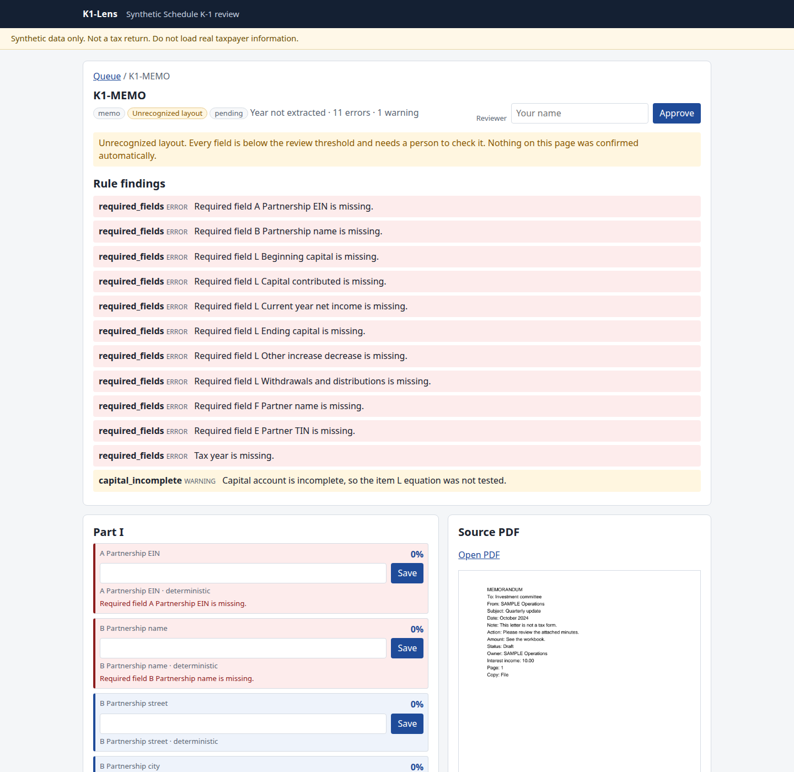

# Design

This is the pipeline behind the README diagram. Decisions and the options that were set aside are in [DECISIONS.md](DECISIONS.md).

The schema is Pydantic v2. Each scalar is an `Extracted` value: the parsed value, a confidence from 0 to 1, and provenance (page, bounding box in PDF coordinates, field label, extractor name). Part I is the partnership. Part II is the partner, sharing percentages, liabilities, and the item L capital account: beginning, contributed, current-year net income, other increase (decrease), withdrawals and distributions, ending. Part III covers the practical boxes 1 through 21, with coded lines for boxes 11, 13, 14, 15, 17, 18, 19, and 20. Those boxes draw from a small set of IRS-style codes, more than one per box across the corpus, such as 11A, 11B, 11C, 11E and 11F, 13W, 15P, and 19A with 19C. `synthetic` must stay true.

The generator is `random.Random` seeded at 1065. The same seed and count rewrite the same PDFs and JSON. Amounts depend on the seed and the document index. Defects are applied after the consistent record is built. Variants: clean, rotated, rasterized, missing fields, inconsistent capital (ending increased by 5000.00), invalid EIN, invalid percentage. A test checks that two generations of the same seed are byte-identical. The PDFs and JSON are not stored in git.

The deterministic extractor reads pdfplumber words and groups them into lines. A `Label: value` line is read as written. A line with no colon is paired by x/y: the longest prefix that resolves to a catalog label or a public line name, then the value to its right, including a right-aligned amount. A second resolved label on that baseline starts another column. A name that has left its label and then jumps across a gutter into an amount is that next column and is not stored. Whether a next line is the name is decided by the name shape, not by a phrase list. A street, a numbered heading that is not itself a name, a line that ends in a role word, a line that contains by, or a line made only of caption words is not stored, and the label stays open. A status phrase or an agency header that fails the shape is stored and held under 0.80. When the printed caption is longer than the catalog label, the whole caption is consumed before the value is taken. A run of three or more identical non-alphanumeric characters is a leader, and so is a mixed run of dots, underscores, hyphens, equals signs, tildes, asterisks, and colons. A leader glued to the value is stripped. A hyphen inside a name stays. A box token alone can anchor a unique box when the value fits that field: money or a percent on an amount box, an EIN, a two-letter state, or yes or no. A letter code plus an amount is not a Part I box. A ruled grid is read as cells, last cell as the amount. OCR keeps Tesseract word boxes and uses the same pairing. Tesseract is called with a subprocess timeout of 120 seconds and ``OMP_THREAD_LIMIT=1`` on the child environment. Eval, live eval, and the Docker image set the same limit. A page that fails OCR, including a timeout or a killed Tesseract process, is recorded on the document as `ocr_failed_pages`. Rule `ocr_page` is an error, so the document cannot go straight through or be approved until a person overrides that finding. An exact catalog label is the first choice. Anything else is matched from the public Schedule K-1 (Form 1065) box numbers, line names, and codes. The matcher lowercases and strips punctuation. Abbreviations are only tokens the IRS prints in the Partner's Instructions or on the form (EIN, SSN, TIN, PTP, AMT) or general accounting shortenings of words the form spells out. Each key in `extract/labels.py` is commented with that source category. A unique box can anchor a line. A shared box, such as item L, needs the description to beat the other lines in that box by a margin. A line that names a different box, or that ties two fields, is left blank. Two labels that disagree on one scalar are a conflict: the field is kept and its confidence is forced under the review threshold. Two coded lines with the same letter and different amounts are both kept, as `box[CODE]` and `box[CODE]#2`. An amount made of two whitespace-separated numbers is rejected, so `1,000 2,000` does not become 10002000. A trailing footnote marker (`*`, `†`, `‡`, `#`, `§`, or `(1)`) is stripped. `NaN` and `Infinity` do not parse. Confidence is the sum of a few signals, clipped to 0-1: that label score, a text layer versus Tesseract's mean word confidence, how close the value sits to the label, whether the token parsed, whether an EIN, TIN, percentage, or withdrawal has a legal shape, and a penalty on the six item L fields when that account does not tie. A token that fails to parse is capped at 0.25. A value on the next line in the caption's own column is paired as that field. An amount on a full text-layer score can clear 0.80. An identity value stays under 0.80 until a confident id and a full exact roster match lift it to exactly 0.80. A 1.2° rotation splits a printed line across pdfplumber's 3-point line tolerance, so those fields stay under 0.80 while the text layer still contains the string. The default review threshold is 0.80. `k1lens serve --threshold` and `K1LENS_REVIEW_THRESHOLD` change it. A page with no words is sent to OCR even when another page of the same PDF has a text layer. A PDF that cannot be opened is recorded with `ocr_failed_pages` of page 1. When a PDF has no field labels and Tesseract is installed, the same label parser runs on OCR lines. A label one edit from exactly one known field label is accepted at a lower label score. Separator punctuation at the edge of a string, such as a comma or a semicolon, is dropped on every value, not only on OCR. A period in an abbreviation or an initial is kept. On an OCR colon line a trailing period is kept when the last token is abbreviation-shaped: a short title-case token such as Bros., Esq., Assoc., or Jr., or initials such as J. R. or L.P. Yes, No, True, and False are not abbreviations, so that separator period is dropped, and a trailing period on a capital-method checkbox is dropped before the method is matched. A separator period after any other token, including an all-caps LLC., is dropped. Name, street, city, state, and ZIP are lifted to exactly 0.80, and not higher, only when a roster is passed, the key id was read confidently and passes the format check, and every field in that section matches the same record. Each value has to come from its own field region, with no fallback, repair, or model value. A partial match lifts nothing. The partnership section is keyed by the EIN read from the form. The partner section is keyed by the TIN. The stored value is the page string. The roster value is never written over it. Each lifted field is an audit row whose action is roster_exact_match. A lift needs a confident id plus a full exact match. Unseen layouts are not supported. Match is case and whitespace for names, streets, cities, and states. ZIP drops whitespace and keeps the hyphen, so ZIP5 does not match ZIP+4. A middle initial added or dropped does not match. A blank field on the page against a complete roster record is held. A roster record with a blank field cannot clear that field. The right id with the wrong name, the right id with the wrong address, and a name from a different record are held. Two roster records with the same EIN or TIN are duplicate_roster_key and are not a match. An id is a key only as an exact read: nine digits, the EIN or SSN dash pattern, and not masked. EINs starting with 00- and SSNs starting with 000- are accepted. Those ranges are obviously synthetic. They are not issued by the IRS or SSA. Asterisks, Xs, or only the last four digits are not a key. Digits are not repaired, guessed, or check-digit-corrected. If OCR word confidence on any id digit is under the review threshold, the id is not a match. A text-layer id whose own confidence is under the threshold is not a key. Entity type is not in the roster set. The form prints no options for that item, and a roster match does not clear it. Periods are ignored, so L.L.C. is LLC. C corp and Income tax basis stay under 0.80. A wrapped value whose next line in the same column was not read stays under 0.80. The missing words are not invented. An unrecognized layout, a conflict, a value that is not grounded, and a value that is not anchored stay under 0.80 after a roster match. Shape checks and caption position do not lift a field to 0.80, and they do not block a roster match. A statement, supplemental, or other-form row is not stored as a street, city, state, or ZIP. A blank name is not filled from the city line. A trailing period on a city is stripped. A value whose first word is see, refer, or enclosed is not stored. An IRS center must be one the Form 1065 instructions name. `K1LENS_ENABLE_OCR=0` skips OCR.

A document is an unrecognized layout when fewer than four lines match strongly, or when the strong matches are under half of the printed lines. The flag is `layout_recognized` on the document, not on each page. Every confidence on that document is then capped below the review threshold. At the default 0.80 the cap is 0.49. A lower `--threshold` lowers the cap with it, so the cap stays under the line the reviewer is using. The queue and the document page both say "Unrecognized layout". A prose letter is this case, and so is `dev_statement` on the measured run. A catalog facsimile is recognized. `fixtures/dev_b` is also recognized on this run. That recognition is a score on a seen caption style, not a blind test.

The LLM extractor sends the full, unredacted page text (the text layer, or OCR text for a scan) to OpenAI or Anthropic and parses a JSON object into the same schema. Page images go only to OpenAI: with vision on, a PDF with no text layer is also sent to OpenAI as low-detail page images. The Anthropic path sends text only. `eval --live` turns vision on (src/k1lens/eval/live.py:458-459). Names, addresses and full TINs therefore leave the machine on this path; see "Privacy and production gaps" in the README. The committed live report is docs/eval-live/report.md, with report-run1.json and report-run2.json beside it, measured on the pre-release source of v0.1.0 (src/ differs from the tag only in one docstring). Confident-wrong is 0 on hybrid and on llm in both runs. No evaluation number in the deterministic sections comes from a live model call. The tests that exercise it are labeled recorded: they play back HTTP responses through `httpx.MockTransport` and do not contact OpenAI or Anthropic. The model's own confidence is one input to the same score, along with the parse, format, and capital checks. A blank line stays null. The model does not fill it with 0.00. A model value that fails the same format check as a deterministic value, or that fails the free-text shape check, is discarded, and the deterministic value or a null is kept. A model value is used only when that string appears in the field's own label region. The region is the words on that baseline after the label and before the next label. A number printed in the next column does not count, and it is not copied onto this field. A swapped pair of on-page amounts does not clear. With no word boxes there is no region, so the model value is not used. The model's confidence is never raised: if the model said 0.30, the stored score stays at most 0.30, including when the value would make a cross-check pass. The model is not on the identity path. A model identity value at any confidence stays under 0.80. Hybrid calls the model when the layout is unrecognized, or when a field is missing or below the review threshold. It stores the model's value only for a missing money or percent amount, a missing coded-line amount, or a missing tax year, and only when that string is in the field's own label region. A value outside that region is not stored. A coded line the rules did not read is stored only when the layout is unrecognized. A field that already has a value keeps the rules value. The stored confidence stays at or below below_review_threshold (0.49 when the threshold is 0.80) and never above the number the model reported. Llm mode never clears a field. Every llm value goes to review. Hybrid keeps the page value when the model disagrees, so a failed item L or guaranteed-payment check stays failed. The LLM-only backend caps every field on an unrecognized layout below 0.80, including a value that is in its label region. The LLM-only path stops on a persistent 5xx after one retry, on a timeout at the first failure, and on a malformed reply after one retry. Hybrid keeps the deterministic values in those three cases and continues. A 429 is retried once, and if it fails again the run stops and the stopped reason includes that status. Any other request failure stops on the first failure, and the stopped reason names the exception class. A 200 whose body is not JSON, and a 200 whose body is not valid UTF-8, are malformed replies. The LLM-only backend also applies the unrecognized-layout cap. Every llm-leg value is capped at LLM_ONLY_CONFIDENCE_CAP (0.79). Hybrid's merge paths cap those model values lower, at below_review_threshold, which is 0.49 when the review threshold is 0.80. A non-finite model confidence is rejected. A finite confidence outside 0 to 1 is clamped. Deterministic fields on an unrecognized document stay capped. With no API key and no injected client, hybrid returns the deterministic record and does not call a model. `uv run k1lens eval --backend hybrid --live` calls OpenAI on every set once OPENAI_API_KEY is set. The default command writes docs/eval-live/report.md and docs/eval-live/report.json. A default eval --live run overwrites docs/eval-live/report.md. The command stops before a call that would pass the spend ceiling (default $3), and does not print the key. `K1LENS_LLM_PROVIDER` selects the vendor; otherwise the first available key wins (`OPENAI_API_KEY`, then `ANTHROPIC_API_KEY`). An empty text layer uses the OCR text when OCR is enabled, and otherwise returns an empty record without calling the API. The prompt lists the coded-line letters the generator can emit, not only code A.

Item L must satisfy `beginning + contributed + current-year net income + other increase (decrease) − withdrawals = ending` within `Decimal("1.00")`. Withdrawals are positive amounts and are subtracted. Each finding has a rule id, a severity, a field path, and a message. The engine emits these ids:

| Rule | Severity | What it checks |
| --- | --- | --- |
| `required_fields` | error | A required field is empty, or the tax year is missing. |
| `ein_format` | error | The partnership EIN is not `NN-NNNNNNN`. |
| `tin_format` | error | The partner TIN is not an EIN or `NNN-NN-NNNN`. |
| `percentage_range` | error | A sharing percentage is outside 0 to 100. |
| `withdrawals_non_negative` | error | Item L withdrawals, or a box 19 amount, is negative. |
| `capital_reconciles` | error | Item L does not tie within `Decimal("1.00")`. |
| `capital_incomplete` | warning | An item L amount is missing, so the equation was not tested. |
| `guaranteed_payments_total` | warning | Box 4c disagrees with box 4a plus box 4b. |
| `synthetic_marker` | warning | A partnership or partner name lacks SAMPLE. |
| `type_check` | error | A payload fails the schema. |
| `ocr_page` | error | OCR failed on one or more pages. Those pages were not read. |
| `no_roster` | error | No client roster was supplied, so name, street, city, state, and ZIP stay in review. |
| `no_tin` | error | The EIN or TIN is missing, not nine digits in the dash pattern, or masked. |
| `no_roster_match` | error | The EIN or TIN is well formed but not a confident read, so it is not a roster key. |
| `new_partner` | error | The EIN or TIN was read confidently and no roster record uses it. |
| `identity_mismatch` | error | The key matches one record, and a field on that section differs or is blank on either side. |
| `duplicate_roster_key` | error | Two roster records use the same EIN or TIN, so neither is a match. |

The review app is FastAPI with server-rendered Jinja templates. Forms work without JavaScript. A field under the review threshold is highlighted. An unrecognized layout is badged on the queue and on the document, and the document page says every field needs a person. SQLite stores the PDF, the record, the findings, and an append-only audit log. Re-ingesting a document adds audit rows and writes the new extraction underneath the reviewer's work. A human correction stays, with its human provenance. If a non-human value changed, the approval drops back to pending, which is the needs-review queue, and each changed field is an audit row with the old value and the new value. That comparison uses a zero tolerance, so an amount that moved by less than 1.00 reopens the document, and so does a coded line whose only change is the code. An unchanged re-ingest keeps the approval. `k1lens serve --reingest` does not delete the database. Approve and export are refused while any low-confidence field or validation error lacks an override. Each override stores the reason and the exact value it covers. An override of a blank field stores an empty string, and that empty string matches the blank, so the finding is resolved. A value is not required. A later re-ingest that changes that value drops the approval, writes a reopen row, and the old override no longer waives the field. An override of an unknown path is rejected. Approve uses two connections. One connection reads the payload. The issues are checked outside that connection. A second connection updates the row only where `document_id` and `payload_json` still match, and writes the audit row. The audit log is append-only: SQLite triggers abort UPDATE and DELETE. Each row stores the previous row's hash, and that hash covers the actor. A head row stores the row count and the last hash. `audit_log.id` is `INTEGER PRIMARY KEY AUTOINCREMENT`. `k1lens verify-audit` reports a truncated tail, an emptied log whose head is not the empty chain, and a gap in those ids, including a gap that a later append leaves behind. SQLite does not reuse an AUTOINCREMENT id and does not roll the sequence back when an insert is rolled back, so a rolled-back insert can leave a gap. A file that is not SQLite, or a SQLite file with no audit log, exits 1 with one line and no traceback. Edits to the documents table are not checked. Anyone who rewrites the SQLite file can recompute those hashes and rebuild the chain and the head. A 429 is retried once and then stops the run, and the stopped reason includes that status. The LLM-only path stops on a persistent 5xx after one retry, on a timeout at the first failure, and on a malformed reply after one retry. Hybrid keeps the deterministic values on a malformed reply, a non-JSON 200, a non-UTF-8 200, a 5xx, or a timeout. Any other request failure stops on the first failure and the stopped reason names the exception class. `--max-spend` must be a finite number greater than zero. The triggers block UPDATE and DELETE through SQLite. They do not stop a rewritten file. CSV and Excel export include approved rows only, with money written as decimal strings. A cell whose first character is `=`, `+`, `@`, a tab, or a carriage return, or a leading minus that is not a plain number, is prefixed with a quote so a spreadsheet does not treat it as a formula. `GET /api/export/csv` and `GET /api/export/xlsx` are the file endpoints. `/docs` serves Swagger UI 5.17.14 from the package. `/redoc` is off so the app does not load a CDN script.

## Waterfall

`k1lens.waterfall` splits one distribution into return of capital, preferred return, GP catch-up, and carried interest. American style uses the deal's unreturned capital. European style uses fund-level unreturned capital when that amount is set. Preferred return is simple interest. Rates are fractions (`0.08`, `0.20`). A catch-up GP share of 1 pays the catch-up tier to the GP until the GP holds the carry rate of profits above returned capital. Hypothesis tests check that the tiers sum to the distributable amount.

## How this could be extended

The LLM backend is the production hook. The model should be pinned, the prompt and the raw response stored beside the audit row, and this deterministic extractor kept as the offline gate. The model should not approve a record.

Per-customer schema variants belong in the field catalog. A customer pack would add labels and a few rules. The review queue, the audit log, and the export would stay as they are.

Reviewer corrections are already an audit log. The next step is to copy approved rows into a gold set and score the next extractor against that set. Rows that are still pending should not be used as training data.

## Limitations

Privacy and production gaps are listed in the README under "Privacy and production gaps".

The PDFs are labeled facsimiles. They are not IRS form artwork, Schedule K-3, state K-1s, or basis worksheets. Tesseract's 95.4% (125/131) is the two rasterized in-distribution documents, K1-0007 and K1-0008, generated from the seed and measured with Tesseract 5.3.4. The 30 generated scans are 54.8% (1048/1914) at precision 98.8% (1048/1061). That set includes 24 mild scans and six pages that are damaged on purpose. Those six are expected to fail. Two mild catalog scans still misread a withdrawal. Both stay under 0.80 because item L could not be checked. The digits were not rewritten. Docker's Tesseract 5.3.0 was not used for these numbers. CI does not build the Docker image. A photographed IRS form would be harder.

The in-distribution text-layer result and the `layout_shift` result both use the catalog labels. With no roster, in-distribution straight-through is 0.0% (0/14) and `layout_shift` straight-through is 0.0% (0/4). With a roster built from that set's ground truth, the four clean documents clear and `layout_shift` is 4/4. Identity on those documents was known before scoring. `layout_shift` is Times. The catalog facsimiles and `fixtures/dev_b` are both Helvetica. `dev_statement` is 35.9% (92/256) at precision 100.0% (92/92), straight-through 0.0% (0/4), and that layout is unrecognized, so those 92 values are capped below 0.80. Four of the hits are the retirement-plan line. The public caption overlaps the inspected wording "Retirement plan partner flag". That caption was not copied from the fixture. `fixtures/dev_b` is 98.4% (253/257) at precision 100.0% (253/253), straight-through 0.0% (0/4). The four misses are the tax year. That set was seen. Its amounts are K1-0001 through K1-0004 with the captions changed. The field score is this seen caption style. The held-out set is scored by an independent reviewer; not in this repo. It is not a claim about every unseen K-1. Zero of the four dev_b documents would pass without review.

`fixtures/dev_geometry` is a round-trip set. It uses the same catalog strings and seed 1065 as the extractor: a right-aligned amount, a box grid, two columns, a mixed statement, and a label with the amount on the next line in the same column. It is not evidence for an unseen layout. Field accuracy is 100.0% (767/767) at precision 100.0% (767/767). With no roster, document straight-through is 0.0% (0/12) and field straight-through is 304/767. 342 correct fields sit in 0.60-0.79 because the gap to a right-aligned amount lowers proximity, and 121 correct fields sit in 0.40-0.59. 304 fields sit in 0.80-1.00. Distinct confidence values: 18. Expected calibration error: 0.211. With a roster built from this set's ground truth, field straight-through is 424/767 and document straight-through is 3/12 (`stacked` 2/2, `stacked_columns` 1/2). 342 comparisons sit in 0.60-0.79, one stays in 0.40-0.59, and 424 sit in 0.80-1.00 at mean 0.882. Distinct confidence values: 19. Expected calibration error: 0.162. Column membership chooses the value. It is not scored as proximity 1. The weights were not refit. `dev_statement` still misses its capital lines because those captions are not catalog labels. An earlier eight-document cut of this same round-trip was 513/513. That count is not a headline for unseen layouts.

On the measured dev-statement documents, and on a prose letter in the tests, `layout_recognized` is false and every deterministic field is below 0.80. The LLM-only path uses that same cap, including a value that sits next to its own label. The model is not on the identity path. A model identity value at any confidence stays under 0.80. Hybrid calls the model when the layout is unrecognized, or when a field is missing or below the review threshold. It stores the model's value only for a missing money or percent amount, a missing coded-line amount, or a missing tax year, and only when that string is in the field's own label region. A coded line the rules did not read is stored only when the layout is unrecognized. A field that already has a value keeps the rules value. The stored confidence is never higher than the number the model reported and stays at or below below_review_threshold (0.49 when the threshold is 0.80). Llm mode never clears a field. Every llm value goes to review. A gap the model fills is stored at or below below_review_threshold (0.49 when the threshold is 0.80). A value outside that region is not used. A yes/no line that prints both option words puts the unmarked word in the label region, so that word passes the region check. `LLM_ONLY_CONFIDENCE_CAP` is 0.79, one hundredth under the 0.80 review threshold, and that cap still holds when the model reports confidence 1.0. The review UI says the layout was not recognized. The measured numbers in the evaluation note are the deterministic backend, so those dev-statement fields stay under 0.80.

The generator fills current-year net income from a simplified rollup of selected Part III lines. The capital rule checks item L against itself. It does not rebuild item L from Part III. When item L does not tie, or a component is missing so the equation is not tested, confidence on those six fields drops even if each value matches the PDF. Those rows can land in a lower bucket while still counting as correct extractions.

A line that ties two fields is left blank. A label two edits from the catalog can still match when the public line name and box number agree. OCR confidence follows the word confidence and can sit above 0.80. With no roster, 39 of 128 in-distribution OCR fields were routed to review. With the ground-truth roster, 19 of 128 were. Text-layer confidence is coarse on purpose. An exact catalog label, proximity 1 for a short gap, a text-layer source, and a successful parse with no format rule add to 0.92. A passing format check adds 0.08 and lands at 1.00. That is why so many clean text-layer fields share one score. A wide gap, OCR word confidence, a failed parse (capped at 0.25), a failed format check (minus 0.22), and the item L penalty move the score. The weights were not refit. The reliability tables and the expected calibration error describe those stored levels. The in-distribution run's distinct values come mostly from OCR word confidence and from rotated fields at the 0.49 cap. With no roster, in-distribution ECE is 0.213 and there are 83 distinct confidence values. The 0.40-0.59 bucket has 250 comparisons, all correct. The 0.80-1.00 bucket has 594 comparisons and 0 errors. No document clears review. With the ground-truth roster, ECE is 0.180, 84 distinct values, and the 0.80 bucket is 689 comparisons at mean 0.904 with 0 errors. A lifted field is stored at exactly 0.80. The four clean documents clear. On the colon-free development set, with no roster, the same formula produces 18 distinct values and ECE 0.211, because a wide gap lowers proximity and identity fields stay under 0.80. The development-layout run with no roster is straight-through 0.0% (0/8). With the ground-truth roster, layout_shift is 4/4 and dev_statement stays 0/4. Those straight-through floors are this run's no-roster rates, 0/14 and 0/8. They are minimums and have no ceiling.

A 1.2° rotation still has a text layer, so rotated field accuracy is 100.0% (125/125). The baseline split caps those fields below 0.80, and rotated straight-through is 0.0% (0/2). That variant does not stress OCR.

EIN and TIN checks are a format check: nine digits, the dash pattern, and not masked. The `00-` and `000-` prefixes are accepted on purpose. They are obviously synthetic. They are not issued by the IRS or SSA. A masked id is not a match. Digits are not repaired.

The committed live report is docs/eval-live/report.md, measured on the pre-release source of v0.1.0 (src/ differs from the tag only in one docstring). The tests that exercise it are labeled recorded and play back HTTP responses. The numbers above are from the deterministic backend with Tesseract 5.3.4.

The reviewer name is typed into the form. There is no authentication and one SQLite file.

The waterfall is a single distribution. It uses simple interest and has no clawback, management fee, or multi-deal schedule.

